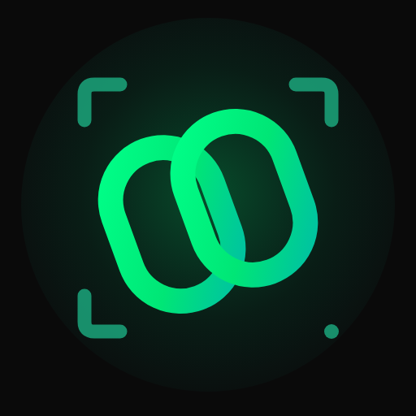

<p align="center">
  
</p>

<h1 align="center">LynkShare</h1>

<p align="center">Encrypted file sharing. No account required.</p>

<p align="center">
  <a href="https://play.google.com/store/apps/details?id=app.xynix.lynk&pli=1"></a>
  <a href="https://lynkshare.app"></a>
  <a href="LICENSE"></a>
  
</p>

## What is LynkShare?

LynkShare is a file-sharing app for Android, with a companion browser experience
at [lynkshare.app](https://lynkshare.app). Select files, choose **Cloud** or
**Direct**, and connect using a QR or Share Code—without creating an account.

The interface separates **Send**, **Receive** and **Activity**. Receiving can
start by scanning a sender QR, entering a Code, or displaying a receiving QR for
the sender to scan. The receiving-QR flow uses Cloud delivery.

## Screenshots

<p align="center">
  
  
  
  
</p>

Screenshots are hosted by Google Play and show the published store presentation;
appearance can differ between releases and themes.

## Features

- **Cloud sharing:** encrypted uploads remain available to multiple recipients
  while the session is active.
- **Direct transfer:** WebRTC connects devices for encrypted transfer while both
  remain online. A TURN relay may carry encrypted traffic when a direct network
  path is unavailable; this is not a guarantee of server-free networking.
- **QR and Code pairing:** scan using the camera, pick a QR image from the gallery,
  or enter a Code. Sender QR and receiving QR have distinct instructions.
- **File review:** select multiple files, review the combined size and remove
  items before starting a transfer.
- **Activity:** recent sent and received transfers, with file opening and re-send
  actions where the original files remain available.
- **Light, Dark and System:** a saved appearance preference, with System following
  device appearance.
- **Device-side encryption:** file contents are encrypted before transfer and
  decrypted on the receiving device.

An internet connection is required. Nearby-device discovery and offline LAN
sharing are not current features. Native app distribution is Android; iOS access
is through the browser, not an App Store app.

## Transfer limits

Each limit is the **combined size of all files in one transfer**, not an allowance
for each file.

| Client | Cloud | Direct |
| --- | --- | --- |
| Android, free | 15 MB | 20 MB |
| Android, unlocked | 30 MB | 50 MB |
| Website | 10 MB | 10 MB |

Transfers support up to **10 files**, subject to the combined size limit. The
backend ceiling is **50 MB per transfer**. Website transfers currently have no
unlock flow. App unlocks and advertising availability follow the in-app policy;
no account or subscription is required to start sharing.

## Privacy and security

- File contents use device-side AES-256-CBC encryption with a random IV. The
  backend does not receive the file-decryption key. This file format does not
  include an authenticated-encryption tag; it is not a claim of an independent
  security audit.
- Shared links carry decryption credentials in the URL fragment. Code pairing
  exchanges wrapped credentials. **Treat complete links, QR images and Codes as
  sensitive** and share only with intended recipients.
- The service processes metadata, including file names, sizes, types, transfer
  identifiers and network addresses. Encryption does not make that metadata
  private or make the service anonymous.
- Cloud session availability is separate from storage cleanup. Sessions normally
  last 10 minutes and can be extended to 30 minutes; encrypted objects may remain
  until the bucket's cleanup policy runs, rather than disappearing at expiry.
- Direct connections can expose network addresses to the other peer and signaling
  infrastructure. Relay services can observe connection metadata, not plaintext
  file contents.
- The Android app contains advertising and Google consent/privacy controls.
  Third-party SDK data practices are covered by the
  [privacy policy](https://sites.google.com/view/lynk-privacy-policy/).

Report suspected vulnerabilities privately using [SECURITY.md](SECURITY.md),
not a public issue. No transfer tool can guarantee safety for untrusted files.

## Build and run

The release pipeline pins Flutter **3.44.6**. Use a Flutter/Dart toolchain that
satisfies `pubspec.yaml`, plus the Android SDK. Dependencies retain their own
licenses and any applicable setup requirements.

Clone this repository, open its root (the directory containing `pubspec.yaml`),
and create an ignored `.env` file:

```env
API_BASE_URL=https://api.lynkshare.app/api/v1/
PRIVACY_POLICY_URL=https://sites.google.com/view/lynk-privacy-policy/
DEEP_LINK_BASE_URL=https://lynkshare.app
```

For a local backend on an Android emulator, use
`http://10.0.2.2:8000/api/v1/` in a debug build. Never add storage credentials,
publishing tokens or private signing keys to the app's bundled configuration.
Debug/profile builds use test ad identifiers.

```sh
flutter pub get
flutter run
```

Development does not require publishing a Shorebird baseline. Keep the existing
`shorebird.yaml` app identity unchanged; do not reinitialize it with `--force`.

## Development and contributions

State is managed with Riverpod, navigation with GoRouter, and HTTP with Dio.
Features are organized into domain, data and presentation layers under
`lib/features`; shared routing, services, providers and widgets live in `lib/core`.

```sh
flutter analyze
flutter test
```

Tests cover routing, cancellation, encryption interoperability, transfer lifecycle,
appearance, consent and release guards. Mocked transports are not a substitute for
real-device transfer and browser testing.

For bug reports, include the app version, device/OS and sanitized reproduction
steps. Keep changes focused and include regression tests. Do not attach private
files, complete QR payloads, tokens or signed URLs to issues or pull requests.
Security-sensitive reports must follow [SECURITY.md](SECURITY.md).

### Releases and Dart patches

Codemagic's manual `lynk-android-release` workflow creates a Shorebird-enabled
baseline and publishes to Play open testing. The separate manual
`lynk-android-patch` workflow targets an **exact baseline version and build** and
publishes to **Shorebird staging only**, without uploading to Play.

Existing ordinary Flutter installations need a Shorebird-enabled Play baseline
before receiving patches. Native code, assets (including `.env`) and Flutter SDK
changes require a new store baseline. Patches apply on a subsequent process
launch, not by restarting an active transfer. Play tracks and Shorebird patch
tracks are separate.

Retain AABs, Dart symbols, R8 mappings and the baseline configuration fingerprint.
See the [release runbook](docs/release-process.md) for secure CI access, staging
preview, explicit promotion/rollback and device checks. Nothing publishes on push.

## License

Copyright (c) 2026 Mudit Palvadi

The LynkShare client source in this repository is licensed under the **GNU General
Public License, version 3 only** (`GPL-3.0-only`). See [LICENSE](LICENSE) for the
full terms. Third-party components retain their respective licenses and notices.

Distribution of covered modifications requires compliance with GPLv3, including
the corresponding-source and notice requirements. GPLv3 permits commercial use
and sale; this is **not** a non-commercial license. Earlier valid license grants
are not revoked by this change. No trademark permission is granted here.
