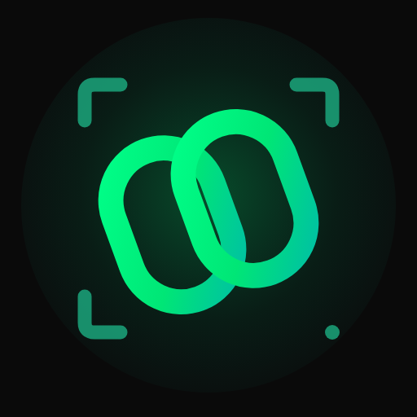

<div align="center">



# LynkShare

**Encrypted file sharing for Android and the web, without an account**

[](https://github.com/mudit-palvadi/lynk-client/stargazers)
[](https://github.com/mudit-palvadi/lynk-client/network/members)
[](https://github.com/mudit-palvadi/lynk-client/issues)
[](LICENSE)
[](https://flutter.dev)

<br/>

[](https://play.google.com/store/apps/details?id=app.xynix.lynk)

[Open LynkShare in your browser](https://lynkshare.app)

</div>

---

<p align="center">
  
  
  
  
</p>

Screenshots come from the Google Play listing. Appearance can vary by release and theme.

## What is LynkShare?

LynkShare is a fast, privacy-conscious file-sharing app for Android and the web.
No account or sign-up is required. Pick your files, choose **Cloud** or **Direct**,
and connect with a QR code or short Share Code.

File contents are encrypted on the sending device and decrypted on the receiving
device. The backend does not receive the file-decryption key. Cloud sharing keeps
encrypted files available to recipients while the session is active. Direct
transfer connects devices over WebRTC while both remain online.

## Features

### ☁️ Cloud sharing

- Upload encrypted files once and share them with one or more recipients while
  the session is active.
- Start with a sender QR, a receiving QR, or a Share Code.
- Sessions normally last 10 minutes and can be extended to 30 minutes.
- The receiving-QR flow uses Cloud delivery.

### ⚡ Direct transfer

- Connect two devices over WebRTC for an encrypted transfer while both remain
  online.
- A TURN relay may carry encrypted traffic when a direct network path is
  unavailable. This is not a guarantee of server-free networking.

### 🔗 Pairing and files

- Scan a QR with the camera, pick a QR image from the gallery, or enter a Code.
- Sender QR and receiving QR have distinct instructions.
- Select up to 10 files, review the combined size, and remove items before
  starting.
- Open received files and re-send recent transfers where the originals remain
  available.

### 🎨 Personalization

- Choose **Light**, **Dark**, or **System** appearance.
- The selected theme is saved, and **System** follows your device appearance.

### 📱 Android and web

- The native app is distributed on Android through Google Play.
- Open [lynkshare.app](https://lynkshare.app) in a browser to use LynkShare on
  other devices, including iOS.
- An internet connection is required. Nearby-device discovery and offline LAN
  sharing are not current features.

## Transfer limits

Each limit is the **combined size of all files in one transfer**, not an allowance
for each file.

| Client | Cloud | Direct |
| --- | --- | --- |
| Android, free | 15 MB | 20 MB |
| Android, unlocked | 30 MB | 50 MB |
| Website | 10 MB | 10 MB |

Transfers support up to **10 files**, subject to the combined size limit. The
backend ceiling is **50 MB per transfer**. Website transfers currently have no
unlock flow. App unlocks and advertising availability follow the in-app policy;
no account or subscription is required to start sharing.

## Privacy and security

- File contents use device-side AES-256-CBC encryption with a random IV. The
  backend does not receive the file-decryption key. This file format does not
  include an authenticated-encryption tag; it is not a claim of an independent
  security audit.
- Shared links carry decryption credentials in the URL fragment. Code pairing
  exchanges wrapped credentials. **Treat complete links, QR images and Codes as
  sensitive** and share only with intended recipients.
- The service processes metadata, including file names, sizes, types, transfer
  identifiers and network addresses. Encryption does not make that metadata
  private or make the service anonymous.
- Cloud session availability is separate from storage cleanup. Sessions normally
  last 10 minutes and can be extended to 30 minutes; encrypted objects may remain
  until the bucket's cleanup policy runs, rather than disappearing at expiry.
- Direct connections can expose network addresses to the other peer and signaling
  infrastructure. Relay services can observe connection metadata, not plaintext
  file contents.
- The Android app contains advertising and Google consent/privacy controls.
  Third-party SDK data practices are covered by the
  [privacy policy](https://sites.google.com/view/lynk-privacy-policy/).

Report suspected vulnerabilities privately using [SECURITY.md](SECURITY.md),
not a public issue. No transfer tool can guarantee safety for untrusted files.

## Run it locally

**Requirements**

- Flutter **3.44.6** (the release pipeline's pinned version)
- A Dart toolchain that satisfies `pubspec.yaml`
- The Android SDK
- Python **3.10+**, Redis, and a Cloudflare R2 bucket you create yourself

LynkShare needs a backend for signaling, receiver sessions and encrypted cloud
storage. Run your own copy; do not point local builds at the project's
production service or storage bucket. The backend lives at
[mudit-palvadi/lynk-backend](https://github.com/mudit-palvadi/lynk-backend).

### 1. Start the backend

Start Redis locally on port `6379`, then set up the backend:

```sh
git clone https://github.com/mudit-palvadi/lynk-backend.git
cd lynk-backend
python -m venv .venv
# Windows PowerShell: .venv\Scripts\Activate.ps1
# macOS/Linux:       source .venv/bin/activate
pip install -r requirements.txt -r requirements-dev.txt
```

Create `.env` in the backend repository root and fill in **your own**
Cloudflare R2 credentials:

```env
ENVIRONMENT=development
PORT=8000
HOST=0.0.0.0
REDIS_URL=redis://localhost:6379/0

R2_ACCOUNT_ID=your-cloudflare-account-id
R2_ACCESS_KEY_ID=your-access-key-id
R2_SECRET_ACCESS_KEY=your-secret-access-key
R2_BUCKET_NAME=your-bucket-name
```

Create that bucket in your own Cloudflare account and give the API token
read/write access to it. The backend supports Cloudflare R2 only, and its
`mock-*` defaults cannot store files; without your own bucket, cloud transfers
fail.

```sh
uvicorn app.main:app --reload
```

The API is then at `http://localhost:8000`, with interactive docs at
`http://localhost:8000/docs`.

### 2. Configure the client

Open this repository's root (the directory containing `pubspec.yaml`) and copy
the example environment file:

```sh
cp .env.example .env
```

Set `API_BASE_URL` for the device you are running:

| Target | `API_BASE_URL` |
| --- | --- |
| Android emulator | `http://10.0.2.2:8000/api/v1/` |
| Web or desktop | `http://localhost:8000/api/v1/` |
| Physical Android device | `http://localhost:8000/api/v1/` after `adb reverse tcp:8000 tcp:8000`, or `http://<computer-lan-ip>:8000/api/v1/` |

`API_BASE_URL` is required. If it is missing, the app throws a configuration
error naming the variable instead of falling back to a hosted service.

`PRIVACY_POLICY_URL` and `DEEP_LINK_BASE_URL` are public product links. Never
put storage credentials, publishing tokens or signing keys in the client's
`.env`; that file is bundled into the app. Debug and profile builds use
Google's test ad identifiers automatically.

```sh
flutter pub get
flutter run
```

Do not commit `.env`. Development does not require publishing a Shorebird
baseline. Keep the existing `shorebird.yaml` app identity unchanged; do not
reinitialize it with `--force`.

## Contributing

Contributions are welcome. Here is how to help:

- **Bug reports and feature requests** → [open an issue](https://github.com/mudit-palvadi/lynk-client/issues).
- **Code contributions** → fork the repository, create a focused branch, and open
  a pull request. Please open an issue first for large changes.
- **Security reports** → follow [SECURITY.md](SECURITY.md); do not open a public
  issue containing vulnerability details.

For bug reports, include the app version, device/OS and sanitized reproduction
steps. Keep changes focused and include regression tests. Do not attach private
files, complete QR payloads, tokens or signed URLs to issues or pull requests.

```sh
flutter analyze
flutter test
```

Tests cover routing, cancellation, encryption interoperability, transfer
lifecycle, appearance, consent and release guards. Mocked transports are not a
substitute for real-device transfer and browser testing.

### Releases and Dart patches

Codemagic's manual `lynk-android-release` workflow creates a Shorebird-enabled
baseline and publishes to Play open testing. The separate manual
`lynk-android-patch` workflow targets an **exact baseline version and build** and
publishes to **Shorebird staging only**, without uploading to Play.

Existing ordinary Flutter installations need a Shorebird-enabled Play baseline
before receiving patches. Native code, assets (including `.env`) and Flutter SDK
changes require a new store baseline. Patches apply on a subsequent process
launch, not by restarting an active transfer. Play tracks and Shorebird patch
tracks are separate.

Retain AABs, Dart symbols, R8 mappings and the baseline configuration fingerprint.
See the [release runbook](docs/release-process.md) for secure CI access, staging
preview, explicit promotion/rollback and device checks. Nothing publishes on push.

## Support the project

- ⭐ Star the repository to help others find LynkShare.
- 💬 Leave a review on [Google Play](https://play.google.com/store/apps/details?id=app.xynix.lynk).
- 🐛 [Report a bug or suggest a feature](https://github.com/mudit-palvadi/lynk-client/issues).

## License

Copyright (c) 2026 Mudit Palvadi

LynkShare is released under the
[GNU General Public License v3.0 only](LICENSE) (`GPL-3.0-only`). Third-party
components retain their respective licenses and notices.

Distribution of covered modifications requires compliance with GPLv3, including
the corresponding-source and notice requirements. GPLv3 permits commercial use
and sale; this is **not** a non-commercial license. Earlier valid license grants
are not revoked by this change. No trademark permission is granted here.

---

<div align="center">

**[lynkshare.app](https://lynkshare.app)** &nbsp;·&nbsp; [Privacy Policy](https://sites.google.com/view/lynk-privacy-policy/) &nbsp;·&nbsp; [Security Policy](SECURITY.md)

Made with ❤️ by [Mudit Palvadi](https://github.com/mudit-palvadi)

</div>
